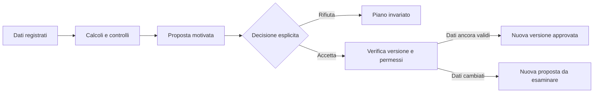

# Piano operativo — applicazione allenamenti

Stato del codice locale del 13 ottobre: [incremento schede/sync/motore](qualita/INCREMENTO_SCHEDE_SYNC_MOTORE.md). Import Excel, catalogo personale, calendario e recupero hanno implementazioni/prove locali; metodi attivi, automazione completa e gate provider/dispositivi restano aperti. Il rapporto della baseline pubblicata sotto non sostituisce questo aggiornamento e nessuna fase è chiusa implicitamente.

Versione 1.3 del 12 ottobre 2026. Specifica della versione completa per lo sviluppo. Le scelte confermate sono distinte dalle raccomandazioni tecniche e dai parametri da validare. Alpha locale, Preview e dominio stabile Production sono collegati a Supabase: DEC-30 autorizza la pubblicazione dell'alpha, con database condiviso dichiarato. Requisiti e funzioni qui descritti sono completati soltanto con le prove di fase. Stato effettivo nel [rapporto implementazione](qualita/STATO_IMPLEMENTAZIONE.md), evidenze del link corto nel [rapporto rilascio](qualita/RILASCIO_DOMINIO_STABILE.md).

## Come leggere questo piano

Incremento prioritario richiesto il 13 ottobre 2026: [sincronizzazione, gestione schede e motore](piani/PIANO_PROSSIME_FUNZIONI.md). Il piano dedicato specifica ticket, scelte tecniche, dipendenze, migrazioni e prove delle prossime consegne, mantenendo il perimetro completo definito qui.

Questo file definisce obiettivi, struttura derivata dall'Excel, funzioni e invarianti. La [roadmap](ROADMAP_SVILUPPO.md) definisce ordine, attività e consegne. Le [scelte tecniche](architettura/SCELTE_TECNICHE.md) confrontano strumenti e alternative; le specifiche specialistiche descrivono dati, API, sicurezza, UX e import. L'[indice generale](README.md) permette di assegnare le letture per ruolo.

Sezioni 1–2: perimetro e fonti. Sezioni 3–5: esperienza, funzioni e controllo finale. Sezioni 6–10: sintesi delle responsabilità tecniche, da implementare con le specifiche collegate. Sezioni 11–14: qualità, criteri di completamento e tracciabilità.

## 1. Obiettivo e decisioni confermate

Realizzare un'applicazione che trasformi la struttura del file Excel in un'esperienza personale, utilizzabile durante l'allenamento e per programmare i cicli successivi. Ogni utente deve poter creare o farsi proporre una scheda, registrare le serie, capire i progressi e decidere esplicitamente se applicare le modifiche suggerite.

| Tema | Decisione dell'utente |
| --- | --- |
| Piattaforma | Web app installabile, utilizzabile da telefono e PC |
| Accesso | Registrazione aperta a tutti, gratuita |
| Metodi di accesso | Email/password e Google |
| Proprietà | Ogni persona gestisce le proprie schede e i propri dati |
| Condivisione | Invio di una copia indipendente della scheda |
| Automazione | Massima automazione di preparazione, analisi e proposte |
| Controllo | Ogni modifica proposta richiede accettazione esplicita |
| Generazione | Schede per ipertrofia e forza, palestra, home gym e corpo libero |
| Assistente | Conversazione AI per spiegazioni e richieste, con lo stesso obbligo di conferma |
| Offline | Registrazione dell'intero allenamento senza connessione |
| Misure e nutrizione | Misure, peso, obiettivi calorici e macronutrienti |
| Fonti | Excel e note pertinenti del vault `C:\Users\peret\Documents\OBS - secondBrain` |
| Importazione | Excel fornito e formato standard documentato |
| Destinatari della generazione | Adulti che si allenano; esclusi percorsi clinici e riabilitativi |
| Vincoli economici e temporali | Nessun limite imposto dall'utente |
| Database | Supabase/PostgreSQL confermato; prevale sul richiamo a MySQLi nelle raccolte |
| Metodo di sviluppo | Seguire entrambe le cartelle `Appunti sviluppo web/` e `Linee guida sviluppo web/`; segnalare i conflitti |
| Commenti nel codice | Mirati e completi su motivazioni, regole, sicurezza e passaggi non ovvi |

Le fasi servono a validare qualità e dipendenze. Non costituiscono una riduzione del prodotto finale. Registrazione pubblica significa predisporre capacità, gestione degli abusi e supporto anche se i primi utilizzatori saranno amici.

Documenti complementari: [roadmap di sviluppo](ROADMAP_SVILUPPO.md) per esecuzione e collaudo; [fonti e algoritmi](FONTI_E_ALGORITMI.md) per regole e provenienza; [decisioni e domande](DECISIONI_E_DOMANDE.md) per le scelte residue.

Il successo del prodotto è verificabile quando una persona nuova crea o accetta una scheda, completa una seduta senza rete, ritrova i dati dopo riapertura, sincronizza su PC e comprende una proposta prima di decidere. La ricchezza di grafici o AI non compensa il fallimento di questo percorso.

### 1.1 Riferimenti obbligatori per chi sviluppa

Leggere e seguire entrambe le raccolte presenti nella radice del progetto: `Appunti sviluppo web/` e `Linee guida sviluppo web/`. Consultare gli indici prima di iniziare e i capitoli completi pertinenti prima di implementare ogni modulo. La [matrice delle convenzioni](CONVENZIONI_SVILUPPO.md) collega fonti, fasi e verifiche; conservarla insieme agli originali nella consegna. Le istruzioni esplicite del committente prevalgono: Supabase è confermato, mentre gli altri conflitti devono essere segnalati e risolti in modo documentato.

## 2. Struttura realmente osservata nell'Excel

Fonte: `SCHEDA PALESTRA 3 GIORNI.xlsx`, SHA-256 `F25B4134E29327E58ECB24AF9CC567ABE4EAA79F06D9035D99C0BF09D2DA69CD`. Il file è stato letto senza modificarlo. Non è stata eseguita una validazione scientifica delle prescrizioni.

| Foglio e intervallo esaminato | Contenuto | Traduzione nell'app |
| --- | --- | --- |
| Leggimi, A1:B86 | Profilo, istruzioni, progressioni, riscaldamento, protocollo per lato, fonti | Onboarding, guida contestuale, preferenze e spiegazioni dei metodi |
| Scheda, A1:Q37 | Giorni, esercizi, serie, range ripetizioni, RIR, recupero, muscoli, note, extra e durata stimata | Editor di schede, libreria esercizi, anteprima del programma |
| Periodizzazione, A1:G19 | Sette settimane con test, base, accumulo, picco e scarico | Cicli di durata variabile, fasi e obiettivi per settimana |
| Diario A, A1:AF50 | Serie, carichi, ripetizioni per lato, RIR, date ed esiti | Sessione attiva e storico |
| Diario B, A1:AF50 | Stessa struttura del giorno B | Stesso componente di diario, alimentato dai dati |
| Diario C, A1:AF54 | Stessa struttura con più esercizi | Stesso componente di diario, senza limiti di righe prefissati |
| Volume, A1:J20 | Serie dirette, indirette ponderate, extra per lato e intervalli di riferimento | Analisi di volume programmato ed effettivo |
| Misure, A1:M19 | Peso, circonferenze, differenze tra lati e note | Registro delle misure e grafici personali |
| Nutrizione, A1:D54 | Stime energetiche, obiettivi macro, medie del peso | Obiettivi nutrizionali e monitoraggio del peso |

La scheda contiene 25 posizioni esercizio: 8 nel giorno A, 8 nel B e 9 nel C. I nomi testuali distinti sono 24; questo non equivale a 24 movimenti canonici, perché una variante può condividere il movimento con un'altra prescrizione. La prima libreria richiede quindi normalizzazione, non semplice deduplicazione per nome.

### 2.1 Elementi da generalizzare

- Tre giorni e sette settimane diventano valori di un modello dimostrativo. L'app deve gestire altri numeri di sedute, cicli e durate.
- Il lato prioritario diventa una preferenza opzionale: nessun utente eredita automaticamente il protocollo per il sinistro.
- Carichi, ripetizioni e RIR sono campi distinti, con target separati dai risultati registrati.
- Muscoli primari e secondari sono relazioni, non nomi incorporati nelle formule.
- Superserie, serie aggiuntive, warm-up e scarico sono entità e regole esplicite.
- Le righe del diario sono generate dinamicamente. Aggiungere una serie non deve richiedere la rigenerazione del programma.
- Le misure di esempio e i valori precompilati nel file non diventano dati reali di un nuovo utente.

### 2.2 Incoerenze da risolvere, non replicare

1. In `Diario A!E11` la formula dell'esito controlla conteggio e minimo delle ripetizioni, senza leggere il RIR. Il testo di `Leggimi!B37` richiede invece il RIR indicato. Il motore deve verificare entrambi.
2. In `Diario A!M11` il numero minimo di risultati richiesti è limitato alle tre serie base, anche nella fase in cui è prevista la quarta. La completezza deve dipendere dalle serie effettivamente prescritte nella versione della sessione.
3. `Nutrizione!D31` può proporre una correzione da una sola variazione settimanale; `Nutrizione!A27` e `A47` chiedono di osservare una tendenza. Nell'app finestra temporale, qualità dei dati e metodo devono essere coerenti.
4. `Nutrizione!B22` tronca i carboidrati a zero quando i macro consumano troppe calorie. L'app deve segnalare un obiettivo incoerente e proporre una correzione da confermare.
5. `Misure!E5:F5` misura uno scarto direzionale DX−SX. Servono scarto con segno, scarto assoluto e denominatore dichiarato; una differenza di segno opposto non deve apparire automaticamente risolta.

## 3. Esperienza di utilizzo e navigazione

Specifiche di componenti, form, accessibilità, temi e stampa in [UX e design](specifiche/UX_E_DESIGN.md).

Su telefono usare cinque destinazioni principali: **Oggi, Programma, Progressi, Libreria, Profilo**. Il diario si apre da Oggi; Misure e Nutrizione sono sottosezioni visibili di Progressi; l'assistente e il centro proposte sono raggiungibili da Oggi e dal Programma. Su desktop usare una barra laterale e viste più ampie. La struttura logica dell'Excel resta riconoscibile senza imporre una tabella larga 32 colonne sul telefono.

### 3.1 Primo accesso

Registrazione → verifica email → dati minimi → obiettivi e attrezzatura → creazione manuale, modello o generazione → anteprima completa → accettazione → prima sessione.

Chiedere progressivamente: obiettivo, esperienza, disponibilità, durata desiderata, luogo e attrezzi, movimenti preferiti/esclusi, unità e carichi disponibili. Peso e parametri per le stime nutrizionali sono richiesti quando si attiva quel modulo. Non rendere foto, misure e questionari estesi necessari per usare il diario.

In assenza di carichi precedenti, proporre una fase di raccolta dati. Non inventare massimali o carichi personali partendo da altezza, sesso o peso corporeo. Dichiarare l'ambito adulto nell'onboarding; la generazione confermata esclude percorsi clinici e riabilitativi. Non raccogliere una storia clinica estesa per poter usare il diario.

### 3.2 Oggi e sessione attiva

Oggi mostra la seduta proposta, durata stimata, settimana/fase, stato della sincronizzazione e modifiche in attesa. “Avvia” apre una sessione con una copia stabile delle prescrizioni approvate.

Per ogni esercizio: nome, eventuale gruppo di superserie, istruzioni brevi, target, risultato precedente, serie da compilare. Per ogni serie: carico, unità/convenzione, ripetizioni, RIR, completata/saltata, eventuali lati. Tastierino numerico, valori precedenti come suggerimenti, pulsanti ampi, annullamento della modifica recente. La precompilazione non equivale a dichiarare una serie eseguita.

Il timer può partire al completamento della serie. Negli esercizi alternati il punto di avvio dipende dal protocollo; nelle superserie il recupero può seguire il giro. L'utente può aggiungere tempo senza alterare retroattivamente il recupero prescritto.

Chiusura → riepilogo e controllo delle serie mancanti → conferma completamento anche parziale → aggiornamento statistiche → eventuali nuove proposte. Il dato reale può differire dal piano: registrarlo non deve essere impedito da una regola di programmazione.

### 3.3 Schermate da progettare

| Schermata | Funzione e stati indispensabili |
| --- | --- |
| Accesso | Registrazione, verifica, login, recupero, sessione scaduta |
| Onboarding | Dati minimi, avanzamento, ripresa, campi facoltativi |
| Oggi | Nessuna scheda, seduta disponibile, sessione da riprendere, offline |
| Programmi | Bozze, attivo, completati, archivio, duplicazione |
| Editor | Giorni, blocchi, esercizi, serie, riordino anche senza trascinamento |
| Ciclo | Settimane, fasi, override, sedute rinviate, nuova versione |
| Generatore | Vincoli, bozza, alternativa, vincoli incompatibili, accettazione |
| Sessione | Target/risultati, timer, sostituzione, serie extra, ripresa |
| Riepilogo | Totali, note, dati mancanti, proposte post-sessione |
| Proposte | Prima/dopo, motivazione, fonti, accetta/rifiuta, obsoleta |
| Storico | Calendario, dettaglio, correzione tracciata, confronto |
| Volume | Programmato/effettivo, diretto/indiretto, periodo, lato |
| Misure | Inserimento, grafici, unità, campioni incompleti |
| Nutrizione | Target correnti, metodo, andamento peso, proposta modifica |
| Libreria | Ricerca, filtri, preferiti, esercizi personali, varianti |
| Condivisione | Anteprima dei dati inclusi, link, importazione, revoca |
| Assistente | Domanda, risposta con fonti, proposta, errore/indisponibilità |
| Profilo | Attrezzatura, unità, dati, account, dispositivi, privacy |

Per tutte le schermate definire caricamento, stato vuoto, errore, permesso negato e modalità offline. Temi chiaro e scuro obbligatori secondo le raccolte, lingua italiana iniziale, struttura pronta alla traduzione. Concordare palette, icona e immagini prima del design definitivo. Predisporre la stampa delle viste informative, delle schede e dei riepiloghi, eliminando i controlli superflui e senza stampare token o link segreti. Nessuna gamification necessaria per completare l'allenamento.

## 4. Funzionalità del prodotto completo

### 4.1 Account e area personale

Email/password e Google, come confermato dall'utente. Recupero password, verifica email, modifica email, logout e gestione delle sessioni. Definire il collegamento tra accessi con la stessa email senza creare due storici separati e senza unire identità senza verifica. Preferenze, strumenti di esportazione e richiesta di cancellazione. Verifica email prima di usare funzioni pubbliche o generazioni costose; limitazioni d'uso documentate contro gli abusi, pur mantenendo il servizio gratuito.

Due aree applicative: personale e amministrativa. L'area amministrativa usa permessi distinti per curare catalogo/contenuti, gestire test e segnalazioni o verificare lo stato del servizio; non assegna automaticamente tutte queste capacità a ogni operatore. Il curatore non dispone di una schermata per sfogliare diari e misure. Eventuali accessi di supporto a dati personali richiedono una procedura separata, temporanea e registrata. Worker e operatori infrastrutturali hanno identità e privilegi tecnici distinti, come nel modello dati; non sono ulteriori ruoli sociali dell'app.

### 4.2 Catalogo esercizi

Catalogo comune curato più esercizi privati dell'utente. Ricerca per nome/sinonimi, muscolo, movimento, attrezzatura e modalità. Ogni variante indica muscoli, istruzioni, tipo di registrazione, unità, unilateralità, impostazioni del carico, incrementi disponibili e possibili alternative.

Un esercizio personale deve funzionare anche senza classificazione completa: il diario resta disponibile, mentre il generatore segnala le informazioni mancanti. Modificare un nome nel catalogo non riscrive lo storico. Archiviazione anziché cancellazione distruttiva delle voci referenziate. Link a dimostrazioni e media con provenienza/licenza verificata.

### 4.3 Programmazione e generazione

Editor manuale completo e generatore guidato condividono lo stesso schema dati. Supportare giorni variabili, blocchi, singole serie con target diversi, superserie, ripetizioni fisse/intervalli, RIR, recuperi, warm-up e note. Durata del ciclo configurabile. Le quantità limite di input sono limiti tecnici espliciti, non il vincolo “tre giorni per sette settimane”.

Il generatore costruisce una bozza da vincoli personali, libreria e metodi approvati. Mostra perché propone split, esercizi, dose e progressione. Se non esiste una soluzione coerente, spiega quali vincoli confliggono e chiede quale rivedere. Non rimuove automaticamente esclusioni o attrezzatura mancante.

Per il corpo libero modellare ripetizioni e/o durata, variante di difficoltà, zavorra o assistenza. Non assimilare un aumento dell'assistenza a un aumento della prestazione e non calcolare tonnellaggi inventati per esercizi senza un carico confrontabile.

### 4.4 Periodizzazione e calendario

Distinguere settimana del ciclo, data programmata e data effettiva. Spostare una seduta non deve far saltare automaticamente una fase. Proposta iniziale: ciclo a settimane esplicite con rinvio assistito delle sedute; eventuali cambiamenti alla distribuzione richiedono conferma. Supportare pausa, ripresa, salto dichiarato e ripetizione di una settimana.

Una modifica al programma produce una nuova versione per il futuro. Sessioni iniziate e concluse mantengono la loro prescrizione originale. Il sistema mostra all'utente da quale seduta entrerà in vigore la modifica.

### 4.5 Progressi, volume e misure

Grafici per esercizio/variante e contesto, carico, ripetizioni, RIR, frequenza effettiva e completamento. Separare miglioramenti osservati da stime. Evitare confronti automatici tra macchine diverse, movimenti diversi o convenzioni di carico differenti.

Volume: serie dirette, contributi indiretti configurabili e serie aggiuntive per lato; sempre separati programmato ed eseguito. Il coefficiente 0,5 dell'Excel è una convenzione del modello, non una misura fisiologica esatta. Gli intervalli di riferimento dipendono dal metodo selezionato e dalla sua versione.

Misure: registrazioni datate, unità, lato, note e condizioni di rilevazione. Peso con una sola fonte dati condivisa dal modulo nutrizione. Valori mancanti non diventano zero; nessuna interpolazione presentata come misura reale. Foto personali fuori dal perimetro iniziale, aggiungibili con progetto specifico di accesso e conservazione.

### 4.6 Nutrizione

Target calorici e macro, storico delle versioni, inserimento manuale, stima trasparente se i dati sono disponibili, pesate e medie settimanali. La priorità proposta è: obiettivo manuale confermato → stima documentata con input completi → richiesta di dati. Non applicare automaticamente una stima grezza come se fosse un dato misurato.

Il monitoraggio propone eventuali aggiornamenti solo con una finestra sufficiente e dati coerenti. Ogni cambio di calorie o macro usa il centro proposte. Il diario alimentare con prodotti, barcode e pasti non è richiesto e resta un'estensione separata. Nessuna stima di grasso corporeo da foto nella versione descritta.

### 4.7 Condivisione per copia

Flusso: selezione scheda/versione → anteprima del contenuto condiviso → creazione link revocabile con scadenza → accesso del destinatario → anteprima → importazione come propria bozza → personalizzazione → accettazione.

Condividere struttura, esercizi necessari e regole di programmazione. Escludere diari, misure, peso, obiettivi nutrizionali personali e carichi reali per impostazione predefinita. Note libere e carichi prescritti possono contenere dati personali: rendere visibile cosa sarà incluso ed eseguire una revisione dedicata.

La copia riceve identificativi propri. Anche gli esercizi privati necessari devono essere copiati o risolti nel catalogo del destinatario. Revocare il link impedisce nuove importazioni, ma non elimina copie già acquisite. Le modifiche dell'autore non aggiornano silenziosamente le copie.

### 4.8 Assistente AI

L'assistente può spiegare la scheda, riassumere progressi e trasformare richieste come “ho solo 45 minuti” in una proposta strutturata. Accede solo ai dati dell'utente e alla raccolta di fonti approvata. Presenta i dati mancanti invece di inventarli.

Non riceve strumenti capaci di applicare direttamente modifiche ai programmi. Produce una bozza conforme allo schema; il motore deterministico controlla vincoli e calcoli; il componente di conferma e il servizio autorizzato applicano la scelta. Se l'AI non è disponibile, diario, schede, calcoli e progressioni locali continuano a funzionare.

## 5. Automazione con controllo finale

Principio vincolante: **calcolare e preparare automaticamente; applicare una proposta solo dopo una decisione esplicita della persona interessata**.

| Azione | Comportamento |
| --- | --- |
| Salvare una serie compilata e confermata | Salvataggio automatico del dato inserito |
| Sincronizzare, aggiornare grafici e medie | Automatico |
| Preparare scheda, progressione o riepilogo | Automatico, senza cambiare target approvati |
| Aumentare carico/serie, cambiare esercizio, anticipare scarico | Proposta con accettazione esplicita |
| Cambiare calorie/macronutrienti o calendario | Proposta con accettazione esplicita |
| Pubblicare un nuovo metodo derivato dal vault | Revisione del contenuto e attivazione amministrativa; programmi esistenti non migrano senza consenso |

Ogni proposta contiene: destinatario, tipo, prima/dopo, motivazione leggibile, prove usate, dati mancanti, fonti, versione dell'algoritmo, versione dei dati, decorrenza e stato. “Accetta” e “Rifiuta” devono essere chiari. Nessuna accettazione per inattività, scorrimento, avvio allenamento o casella preselezionata. Un eventuale “Accetta queste modifiche” conferma soltanto l'elenco visibile di quella specifica proposta.

L'approvazione di un ciclo completo può includere le dosi già mostrate per ciascuna settimana. Non concede un'autorizzazione permanente ad adattamenti futuri. Un rifiuto conserva il piano esistente e non genera immediatamente la stessa domanda senza nuovi elementi.

Accettazione, aggiornamento del piano e registrazione della decisione devono essere atomici sul server e resistenti al doppio clic. Lo storico delle decisioni permette di vedere cosa è cambiato e perché. Un ripristino crea un'altra versione, senza cancellare sessioni già eseguite.

## 6. Architettura e scelta confermata del database

Questa sezione è una sintesi. Il [registro ADR](architettura/SCELTE_TECNICHE.md) stabilisce strumenti raccomandati, alternative, pro/contro e condizioni per rivederli; le [convenzioni](CONVENZIONI_SVILUPPO.md) definiscono come scrivere il codice. Non interpretare Supabase come soluzione automatica di offline, progressioni o consenso.

Supabase/PostgreSQL è confermato dal committente (DEC-18). Questa decisione sostituisce l'indicazione MySQLi nelle raccolte. Le altre componenti della seguente architettura sono proposte da validare nella fase di fondazione:

| Livello | Scelta | Scopo |
| --- | --- | --- |
| Interfaccia | React, TypeScript, Vite | App interattiva centrata su diario ed editor |
| Installazione | Manifest PWA e service worker | Apertura come app e disponibilità dei file essenziali offline |
| Persistenza locale | IndexedDB con Dexie | Diario, copia del programma, coda delle operazioni |
| Backend | Supabase Auth e PostgreSQL | Identità, database condiviso, permessi per proprietario |
| Accesso web autenticato | Livello server applicativo, sullo stesso sito della PWA | Cookie HttpOnly, sessioni e inoltro autorizzato delle operazioni a Supabase |
| Operazioni atomiche | Funzioni database/API controllate | Sincronizzazione, accettazione, copia e cancellazione |
| Motore | Modulo TypeScript puro, versionato | Regole identiche nel client e nel servizio di verifica |
| File | Archivio privato con accessi temporanei | Import/export e futuri allegati |
| AI | Modulo isolato nel server/worker, provider sostituibile | Conversazione, recupero fonti, proposte strutturate; deploy indipendente solo se necessario |
| Erogazione | Hosting HTTPS/CDN con ambienti separati | Distribuzione web, preview e produzione |
| Qualità | Test di dominio, integrazione DB, browser e dispositivi reali | Verifica di calcoli, accessi e flussi |

Scelta motivata: l'esperienza principale è interattiva e personale, mentre i dati hanno relazioni nette tra programmi, sessioni e serie. Si propone un'applicazione modulare unica, evitando di distribuire prematuramente queste relazioni tra molti servizi. Il motore resta separato dall'interfaccia per poter essere riutilizzato in futuro.

Le PWA combinano manifest e funzionalità web per l'esperienza installabile; le capacità effettive vanno provate sui browser bersaglio. [Documentazione MDN](https://developer.mozilla.org/en-US/docs/Web/Progressive_web_apps).

Vite prepara il pacchetto distribuibile dell'interfaccia. [Documentazione Vite](https://vite.dev/guide/build). IndexedDB offre storage strutturato sul dispositivo e Dexie ne semplifica l'accesso. [MDN IndexedDB](https://developer.mozilla.org/en-US/docs/Web/API/IndexedDB_API), [Dexie](https://dexie.org/docs).

Supabase fornisce autenticazione integrata con PostgreSQL; le politiche RLS possono limitare le righe accessibili a ogni utente. La separazione dei dati deve essere verificata anche chiamando direttamente le API. [Supabase Auth](https://supabase.com/docs/guides/auth), [Supabase RLS](https://supabase.com/docs/guides/database/postgres/row-level-security).

Bloccare nel progetto le versioni effettivamente scelte, con lockfile. Rivedere documentazione e changelog all'avvio dell'implementazione, senza fissare qui versioni immaginate. Hosting e provider AI restano decisioni di progetto, non servizi già acquistati.

### 6.1 Sessioni, Supabase e diario offline

Le raccolte richiedono cookie di autenticazione non leggibili da JavaScript. L'integrazione Supabase con sessione gestita nel browser richiede invece accesso ai token: l'uso di cookie in un esempio SSR non equivale automaticamente a HttpOnly. [Guida Supabase](https://supabase.com/docs/guides/auth/server-side/advanced-guide).

Proposta progettuale per rispettare entrambi i requisiti: la PWA chiama un livello server sullo stesso sito, che gestisce login, callback Google e sessioni tramite Supabase Auth. Al browser restituisce un identificativo opaco in cookie `Secure; HttpOnly; SameSite=Lax`; conserva e rinnova i token Supabase lato server in un archivio privato protetto. Le richieste utente verso Supabase mantengono l'identità dell'utente e le policy RLS; non usare la chiave privilegiata come scorciatoia per ogni richiesta. Prevedere protezione CSRF, rotazione, scadenze, logout, rinnovi concorrenti e risposte autenticate escluse dalle cache condivise. Questa è una scelta applicativa da provare in F2–F3, non una funzione già implementata o una garanzia del provider.

Il livello server aggiunge lavoro di integrazione, ma evita di costruire un sistema autonomo di credenziali. Supabase Auth resta responsabile della conservazione delle password: la documentazione consultata indica bcrypt con salt. Il suggerimento di provare Argon2id nelle raccolte non impone una seconda tabella password o hashing personalizzato. [Sicurezza password Supabase](https://supabase.com/docs/guides/auth/password-security).

Il diario offline conserva localmente i dati necessari all'allenamento e la coda delle operazioni, separati per account; non conserva password o token di sessione leggibili da JavaScript. Una sessione online scaduta sospende la sincronizzazione e richiede un nuovo accesso senza perdere il lavoro locale. Supabase non sostituisce il protocollo offline descritto nel §9: conflitti, ritentativi e persistenza locale restano lavoro dell'app.

## 7. Modello dati e integrità

Per campi, FK, revisioni, snapshot, grant, RLS, RPC e transazioni applicare [modello dati](specifiche/MODELLO_DATI.md). Il riepilogo seguente orienta il prodotto; non sostituisce la specifica dei vincoli.

Separare quattro piani: catalogo, prescrizioni approvate, risultati effettivi e proposte. I campi comuni alle entità personali sono UUID, proprietario, timestamp UTC, versione incrementale e cancellazione sincronizzabile ove necessaria. Per date di allenamento conservare anche data locale e fuso.

| Entità | Dati e relazioni principali |
| --- | --- |
| profiles / training_preferences | Identità applicativa, unità, obiettivi, disponibilità e preferenze |
| equipment_profiles / equipment_items | Luogo, strumenti disponibili, tagli di carico e convenzioni |
| exercises / exercise_variants | Catalogo condiviso o privato, modalità, attrezzatura, istruzioni |
| muscle_groups / exercise_muscles | Contributi diretti/indiretti e relativo metodo |
| programs / program_versions | Proprietario, bozza/attivo/archiviato, versioni approvate |
| program_days / exercise_blocks | Giorni ordinati, warm-up, singoli esercizi e superserie |
| prescribed_exercises / prescribed_sets | Variante, ordine, target per serie, lato e recupero |
| cycles / cycle_weeks / prescription_overrides | Istanza del ciclo, fasi, obiettivi e differenze per settimana |
| scheduled_sessions | Data prevista, rinvio, stato, collegamento alla settimana del ciclo |
| workout_sessions | Data reale, stato, versione del piano e copia immutabile dei target |
| session_exercises / set_logs | Esercizio svolto, ordine reale, serie, ripetizioni/RIR per lato, carico e qualità dichiarata |
| measurements / weight_entries | Misure con unità e lato; unica fonte delle pesate |
| nutrition_target_versions | Obiettivi approvati, input, metodo, decorrenza e revisione |
| proposals / proposal_decisions | Differenze, prove, fonti, versioni, accettazione/rifiuto e decorrenza |
| share_links / share_imports | Token protetto, scadenza, versione condivisa, copia risultante |
| knowledge_sources / source_revisions | Titolo, provenienza, hash, ambito, stato della revisione |
| rule_sets / rule_versions | Regole approvate, configurazione, fonti e suite di validazione |
| assistant_threads / assistant_messages | Conversazioni personali con conservazione configurata |
| sync_operations / device_cursors | Identificativi idempotenti, versione di base, conferme e cursori |
| import_jobs / export_jobs / audit_events | Operazioni lunghe, esito, accessi privilegiati e decisioni |

Le relazioni figlie devono appartenere allo stesso proprietario del padre, mediante vincoli composti o controlli equivalenti nel database. Non basta un `user_id` nel corpo inviato dal client. Vincoli unici prevengono doppioni di sessioni, serie, decisioni e importazioni ripetute.

Modellare RIR come valore/intervallo numerico; convertire l'eventuale visualizzazione RPE in modo dichiarato. Modellare carico come numero più unità e significato: totale bilanciere, singolo manubrio, pacco pesi identificato, zavorra o assistenza. Modellare esecuzione bilaterale, alternata e simultanea separatamente dal numero di carichi. Non usare valori negativi per significare assistenza senza un campo esplicito.

Le prescrizioni complesse possono avere un payload JSON validato e versionato, ma proprietà, relazioni, stati e campi interrogati di frequente restano strutturati. Indici iniziali su proprietario/data, sessione/ordine, programma/versione ed esercizio/data. Grafici filtrati e paginati, senza scaricare tutta la storia di tutti gli utenti.

## 8. Contratti applicativi

Endpoint, envelope, codici errore, challenge, operazioni offline e idempotenza sono definiti in [API e sincronizzazione](specifiche/API_E_SINCRONIZZAZIONE.md).

Le seguenti sono operazioni logiche da tradurre in API/RPC nella progettazione dettagliata:

| Operazione | Input essenziale | Garanzia |
| --- | --- | --- |
| GenerateProgramDraft | Profilo, vincoli, versione regole | Restituisce bozza o vincoli incompatibili; non attiva |
| StartWorkout | Programma/versione, giorno, UUID client | Sessione unica con snapshot stabile |
| SaveSet | UUID operazione, serie, valore, versione base | Persistenza idempotente e validata |
| FinishWorkout | Sessione/versione, esito completo/parziale | Nessuna serie inventata |
| EvaluateProgression | Snapshot dei risultati e delle regole | Proposta riproducibile o dati insufficienti |
| AcceptProposal | ID, revisione/hash, decisione esplicita | Confronto versioni e applicazione atomica |
| RejectProposal | ID/revisione | Conserva il piano e la decisione |
| ImportSharedProgram | Token, UUID richiesta | Copia coerente senza dati privati dell'autore |
| PushOperations / PullChanges | Operazioni versionate / cursore | Ritentativi senza duplicazione, conflitti espliciti |
| ExportAccount / DeleteAccount | Identità riautenticata | Operazione tracciata e recuperabile dagli errori |

Codici e stati distinti per validazione errata, permessi, proposta obsoleta, duplicato già elaborato, conflitto, servizio indisponibile e autenticazione da rinnovare. L'interfaccia deve poter spiegare il rimedio senza mostrare dettagli del database.

## 9. Offline e sincronizzazione

Specifiche esecutive: [protocollo offline](specifiche/API_E_SINCRONIZZAZIONE.md), con snapshot coerenti, cursori per account, dipendenze tra comandi e procedura di recupero.

Garantire dopo il primo accesso online e il download iniziale: apertura della scheda attiva, avvio/ripresa/chiusura di una sessione, registrazione serie, timer, note e consultazione dello storico già scaricato. Primo login, recupero account, invio link, AI remota e dati mai scaricati richiedono connessione.

Ogni operazione aggiorna il database locale e la coda nella stessa transazione. La UI distingue “Salvato sul dispositivo”, “Sincronizzazione in corso” e “Sincronizzato”. UUID generati sul client; ricevute dal server; tentativi ripetuti con attesa crescente. Al ripristino della rete inviare le operazioni e acquisire le modifiche remote, senza cancellare quelle non confermate.

Due dispositivi possono aggiungere serie con ID distinti. Se modificano lo stesso record dalla stessa versione, il secondo incontra un conflitto: non sovrascrivere silenziosamente. La risoluzione mostra entrambe le versioni. Cancellazioni e ripristini vanno sincronizzati con tombstone e politica di conservazione definita.

Se il database server viene ripristinato a un momento precedente, cambiare la generazione `sync_epoch` e avviare un recupero dedicato: conservare anche la precedente copia locale, confrontarla con la nuova base e riconciliare le operazioni. Non riutilizzare ciecamente i vecchi cursori o ritentare comandi di cui il restore può aver perso le ricevute. Il contratto API distingue questo caso dalla semplice scadenza di un cursore.

Le proposte calcolabili offline usano un pacchetto regole già scaricato. Un'eventuale accettazione offline vale localmente per la revisione esatta mostrata ed è indicata come in attesa di sincronizzazione. Il server rifiuta l'applicazione se i presupposti sono cambiati; la nuova proposta richiede una nuova decisione. Le serie già svolte restano registrazioni reali anche se il piano incontra un conflitto.

La sincronizzazione al ritorno in primo piano è il percorso garantito. Il supporto Background Sync è limitato e non deve essere un requisito implicito per salvare dati. [MDN Background Synchronization](https://developer.mozilla.org/en-US/docs/Web/API/Background_Synchronization_API).

Il timer usa un istante di scadenza, non il conteggio dei tick. Al risveglio ricalcola il tempo trascorso. Suono, vibrazione e notifiche a schermo bloccato sono capacità da verificare sul dispositivo e non promesse universali.

Gestire quota piena, dati locali rimossi dal browser, aggiornamenti della cache e migrazioni del database locale. Non mostrare “salvato” se la scrittura fallisce. Nessun aggiornamento obbligatorio dell'app durante una serie. Separare le cache per account; al logout avvertire solo se esistono dati non sincronizzati e offrire sincronizzazione/esportazione prima di cancellarli.

Il logout offline chiude l'area personale sul dispositivo; la revoca server resta dichiaratamente in attesa. Un marcatore persistente impedisce il rientro automatico e impone di completare il logout remoto prima della sincronizzazione o di un nuovo login. L'uscita dal dispositivo corrente e quella da tutti i dispositivi sono azioni distinte.

## 10. Sicurezza, privacy e gestione del servizio

Flussi e controlli in [sicurezza e privacy](specifiche/SICUREZZA_E_PRIVACY.md); deploy, backup e supporto in [rilascio e manutenzione](operazioni/RILASCIO_E_MANUTENZIONE.md). Regione e servizi gestiti non costituiscono da soli una verifica di conformità.

Regola di prodotto: dati personali privati per impostazione predefinita, compresi profilo, diari, misure, nutrizione e conversazioni. Un link a una scheda non concede accesso all'account. L'AI non riceve il vault completo né il database di altri utenti.

Implementare RLS e grant minimi, controlli server per ogni operazione sensibile, separazione di catalogo pubblico e dati personali, token di condivisione imprevedibili e conservati in forma protetta. Chiavi privilegiate esclusivamente sul server. Ruoli e proprietà non sono modificabili tramite metadati controllati dall'utente.

Per la registrazione pubblica prevedere limitazione dei tentativi, verifica email, protezione delle chiamate costose, segnalazione di contenuti condivisi e blocco degli abusi. Gratuità non implica richieste illimitate ai servizi AI. Le quote tecniche devono essere chiare e non trasformarsi in un abbonamento non richiesto.

Scegliere regione dei dati, responsabili operativi, conservazione e procedure di esportazione/cancellazione prima del rilascio. Includere database, file, conversazioni, indici AI, code e dispositivi nella mappa dei dati. La cancellazione dai backup segue la politica del servizio; un ripristino deve riapplicare le cancellazioni già richieste. Non promettere cancellazione istantanea da un dispositivo offline o da ogni backup.

La revisione privacy deve verificare finalità, minimizzazione e classificazione dei dati raccolti, soprattutto informazioni su condizioni fisiche. Si tratta di un'attività del progetto, non di una certificazione ottenuta con questo documento. [Principi richiamati dalla Commissione europea](https://commission.europa.eu/law/law-topic/data-protection/information-business-and-organisations/application-gdpr_en).

## 11. Qualità e criteri di riuscita

La [matrice di collaudo](qualita/TEST_E_ACCETTAZIONE.md) assegna prove, strumenti, dataset e gate di rilascio. Le soglie seguenti sono obiettivi iniziali, non prestazioni misurate.

Obiettivi di collaudo proposti, da misurare su dispositivi e dati campione dichiarati:

- Registrare una serie senza connessione e ritrovarla dopo chiusura e riapertura dell'app.
- Sincronizzare 100 operazioni ritentate senza duplicati e senza perdita di risultati confermati.
- Dimostrare che due account non possono leggere o modificare i dati reciproci, anche attraverso API e riferimenti figlio contraffatti.
- Dimostrare che una proposta rifiutata o mai accettata non cambia alcun target.
- Interazione di salvataggio locale percepita entro 200 ms al percentile 95 sui dispositivi di prova; caricamento di Oggi entro 2,5 s nelle condizioni di rete concordate.
- Usabilità: completamento senza assistenza di creazione/accettazione scheda, registrazione seduta e copia a un amico da almeno il 90% del gruppo di prova, come target iniziale.
- Interfaccia utilizzabile a 360 px di larghezza, con testo ingrandito, tastiera e lettore di schermo; obiettivo WCAG 2.2 AA da verificare nella fase di accessibilità. [Standard W3C](https://www.w3.org/TR/WCAG22/).
- Nessun dato d'esempio confuso con risultati personali; nessun numero mancante trattato come zero.
- Verifiche WEB-01–WEB-14 delle convenzioni: HTML/CSS generati, contrasto in entrambi i temi, stampa, form, sessioni, cache e prestazioni. Conservare report e prove manuali; usare dati sintetici per strumenti esterni.

Proposte per l'esercizio: disponibilità mensile 99,9% dei percorsi online; obiettivo di recupero del servizio entro 4 ore; perdita massima dei dati già sincronizzati entro 1 ora, da dimensionare con backup appropriati e prove di ripristino. I dati rimasti soltanto sul telefono non rientrano nella garanzia del backup remoto.

Misurare errori di sincronizzazione, crash, fallimenti login, proposte obsolete e successo dei flussi. Le metriche di prodotto devono essere aggregate e ridotte al necessario. Nessun contenuto di chat, misura corporea o token nei log tecnici ordinari.

## 12. Perimetro e risultato atteso

La prima versione completa include tutti i moduli confermati: account pubblici gratuiti, catalogo, editor e generatore, cicli, diario offline, progressioni da confermare, volume, misure, nutrizione essenziale, condivisione per copia e assistente AI.

Estensioni separate: allenatori con assegnazioni, pagamenti, diario alimentare, wearable, app native, social feed, gare e programmazione specifica per endurance. Vanno valutate su richiesta e non inserite come dipendenze occulte del prodotto scelto.

La consegna allo sviluppatore comprende schema dati e migrazioni, prototipi, catalogo iniziale, regole versionate, test, ambienti riproducibili, manuale operativo e procedure di backup. L'obiettivo finale è una persona che si allena con pochi inserimenti, riceve proposte comprensibili e mantiene sempre il controllo delle decisioni.

## 13. Catalogo dei requisiti e tracciabilità

| ID | Requisito verificabile | Specifica principale | Fase / prove |
| --- | --- | --- | --- |
| RF-01 | Accesso pubblico gratuito email/Google, recupero e linking sicuro | Sicurezza | F3 / QA-AUTH |
| RF-02 | Proprietà personale e nessun accesso tra account | Modello dati | F3 / QA-SEC-01/02 |
| RF-03 | Catalogo comune + varianti private con unità e attrezzatura | Modello dati, UX | F4 / fixture catalogo e ALG-09 |
| RF-04 | Schede e cicli di durata variabile, versionati | Modello dati, algoritmi | F4 / ALG-27 |
| RF-05 | Generazione per tutti gli ambiti confermati | Algoritmi | F6 / ALG-16/17/18/30/31 |
| RF-06 | Serie, lati, superserie, timer e chiusura parziale offline | API/sync, UX | F5 / QA-OFF |
| RF-07 | Sync senza duplicati, conflitti visibili e recupero | API/sync | F5 / QA-SYNC |
| RF-08 | Progressioni motivate e accettazione esplicita della revisione | Algoritmi, API/sync | F6 / QA-APP |
| RF-09 | Storico, volume e grafici confrontabili | Algoritmi, modello dati | F7 / ALG-09/10/11 |
| RF-10 | Misure e unica fonte delle pesate | Modello dati | F7 / QA-DATA-01 |
| RF-11 | Target calorie/macro e adattamenti da confermare | Algoritmi | F7 / ALG-19/20 |
| RF-12 | Copie indipendenti e revoca nuovi accessi | Import/export, sicurezza | F8 / QA-SHR |
| RF-13 | Import Excel noto + JSON standard, con anteprima | Import/export | F4/F8 / QA-IMP |
| RF-14 | Export e cancellazione account/dati | Import/export, operazioni | F8 / QA-OPS e fixture export |
| RF-15 | Assistente AI con fonti, vincoli e nessuna applicazione diretta | Algoritmi, sicurezza | F9 / QA-AI, QA-APP-04 |
| RF-16 | Responsive, temi, stampa e accessibilità AA | UX, convenzioni | F1/F10 / WEB-02–06, QA-UX |
| RF-17 | Servizio osservabile, backup/restore e manutenzione | Operazioni | F10/F11 / QA-OPS |
| RF-18 | Codice comprensibile e sviluppo secondo le raccolte | Convenzioni | Tutte / WEB-01–14, revisione |

Ogni requisito è trasversale a più ticket: l'ID non rappresenta una giornata di lavoro. Le prove citate sono riferimenti minimi; la matrice QA contiene i dettagli. Un requisito non è completo se funziona soltanto con dati dimostrativi o su un browser del programmatore.

## 14. Confini e invarianti trasversali

1. Il catalogo o un template non importano dati personali del file Excel nei nuovi account.
2. Prescrizione, proposta, decisione e risultato effettivo sono entità separate.
3. Una modifica futura non riscrive una seduta conclusa; una correzione del diario è esplicita e versionata.
4. Rete assente non impedisce il diario già inizializzato; Auth e AI remote hanno limiti dichiarati.
5. Dati incompleti producono una spiegazione, non numeri inventati.
6. Un rifiuto non viene aggirato da un job, un aggiornamento di regola o una risposta AI.
7. Nessun prototipo, test automatico o documento sostituisce la validazione delle regole di dominio.

Le [estensioni future](SVILUPPI_FUTURI.md) indicano benefici, costi e condizioni per ampliare il prodotto, mantenendo questi invarianti.
