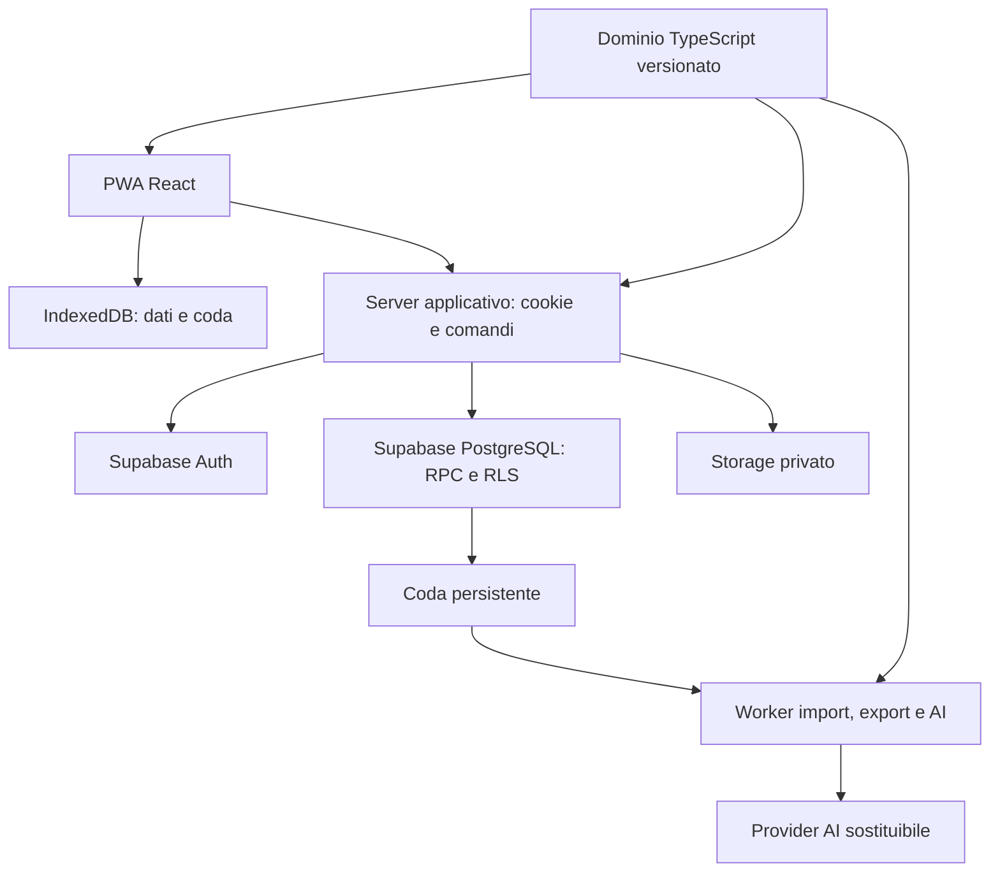

# Architettura e registro delle scelte tecniche

Versione 1.1 · Piano del 10 ottobre 2026. PWA (DEC-01) e Supabase (DEC-18) sono confermati. Le soluzioni raccomandate rispettano le decisioni utente e richiedono le prove indicate. Collegamento remoto autorizzato e verificato successivamente: [rapporto integrazione](../qualita/INTEGRAZIONE_SUPABASE.md).

Aggiornamento implementativo 11 ottobre: [strumenti effettivi, adattamento JSONB, confini e compromessi dell'alpha](SCELTE_IMPLEMENTAZIONE.md). La struttura delle cartelle e le tabelle qui proposte descrivono l'obiettivo; il rapporto collegato distingue ciò che è già nel codice da ciò che manca.

## 1. Criteri di scelta

In ordine: non perdere dati; isolare gli account; applicare solo modifiche confermate; rendere rapido il diario; mantenere il sistema comprensibile; limitare il lavoro operativo. Il budget disponibile non giustifica più servizi, librerie o livelli di astrazione senza un problema misurato.

Architettura raccomandata: applicazione modulare in un unico repository, PWA React e servizio Node/TypeScript, Supabase gestito. Il dominio rimane un pacchetto puro condiviso. Una singola distribuzione server può contenere API e gestione delle sessioni; i job lunghi usano un processo worker dello stesso codice, quando necessari.



Il diagramma indica responsabilità, non l'obbligo di acquistare un servizio per ogni riquadro. Il client non possiede credenziali privilegiate. Le richieste applicative autenticate passano dal server; la sincronizzazione legge e scrive il database locale separatamente dal trasporto di rete.

## 2. Decisioni con alternative e condizioni di revisione

| ID / scelta e stato | Perché e vantaggi | Costi e svantaggi | Alternative considerate / quando rivedere |
| --- | --- | --- | --- |
| ADR-01 · PWA, CONFERMATO | Un'interfaccia per telefono e PC, distribuzione via web, diario locale | Capacità in background e storage dipendono dal browser | Native/Flutter/React Native solo se nuove esigenze lo giustificano e il committente approva un cambio di perimetro; non sostituire la PWA per scelta unilaterale del team |
| ADR-02 · React + TypeScript + Vite | Componenti riutilizzabili e stesso linguaggio nel dominio; build separata dal server | Routing, fetch e offline vanno progettati; Vite non è un backend | Next.js o React Router Framework se SSR e contenuti pubblici diventano centrali; Vue/Svelte validi se il team è molto più esperto, nessuna presunta inferiorità |
| ADR-03 · React Router, modalità dichiarativa | Navigazione separata dal modello locale; gli stati di caricamento e sync appartengono al diario | Code splitting e recupero dati richiedono convenzioni esplicite | Modalità Data/Framework se i loader diventano il centro del prodotto; evitare due sistemi che pretendano di possedere gli stessi dati |
| ADR-04 · Node LTS + Fastify | Server TypeScript piccolo, hook e gestione HTTP organizzati; condivide i contratti | Processo da distribuire e aggiornare, cookie e sessioni da integrare | Next.js per server e UI unificati; Express se esiste competenza consolidata; funzioni serverless se limiti e rinnovi concorrenti sono provati |
| ADR-05 · Supabase/PostgreSQL gestito, CONFERMATO | Relazioni, transazioni e Auth nello stesso servizio di base | Dipendenza da API/provider, costi e quote da monitorare, RLS da progettare | PHP/MySQLi richiede diversa integrazione ed è superato da DEC-18; Firestore cambia modello e transazioni; self-hosting solo con una motivazione operativa |
| ADR-06 · Sessione web opaca HttpOnly | Rispetta le raccolte; token Supabase non leggibili dal JavaScript della PWA | Archivio sessioni protetto, rinnovi coordinati, CSRF e un passaggio server aggiuntivo | Browser SDK diretto più semplice, ma richiederebbe cambiare il requisito HttpOnly; non scelto implicitamente |
| ADR-07 · IndexedDB tramite Dexie | Record strutturati, indici e transazioni per dato + coda | Migrazioni e gestione quota/eviction restano a carico dell'app | localStorage inadatto al diario transazionale; motore sync gestito da valutare se la prova F5 rende eccessivo il costo del protocollo |
| ADR-08 · Sync per comandi + ricevute | Semantica esplicita, idempotenza e conflitti controllabili | Più lavoro rispetto al semplice CRUD online | Last-write-wins perde modifiche senza confronto; CRDT giustificati soprattutto da editing collaborativo simultaneo, che oggi non serve |
| ADR-09 · SQL versionato, SDK Supabase sul server | Accesso e transazioni vicini a RLS e vincoli; nessun ORM da coordinare con le policy | Serve competenza SQL e test di integrazione reali | Prisma/Drizzle se si introduce accesso SQL diretto più ampio; non risolvono da soli RLS, sessioni o consenso |
| ADR-10 · Zod per contratti runtime | Schema condiviso client/server, errori strutturati, inferenza dei tipi | Bundle e manutenzione; uno schema non sostituisce i controlli di proprietà | JSON Schema/Ajv se il team preferisce standard multipiattaforma; evitare due schemi scritti a mano per lo stesso payload |
| ADR-11 · CSS Modules + custom properties | Stili circoscritti, temi e stampa visibili in CSS, aderenza agli appunti | Componenti da comporre e verificare | Tailwind possibile ma non necessario; UI kit completo rapido ma può vincolare diario, stampa e stile. Valutare primitive accessibili prima di costruire widget complessi |
| ADR-12 · Vitest + Testing Library + Playwright | Dominio veloce da testare, UI verificata per comportamento, E2E nei browser | I mock non dimostrano la correttezza del DB o dei telefoni reali | Jest/Cypress validi con competenza esistente; evitare due runner equivalenti senza motivo |
| ADR-13 · vite-plugin-pwa / Workbox, injectManifest | Controllo delle rotte cache e degli aggiornamenti durante una seduta | Service worker personalizzato da collaudare | generateSW per casi più semplici; niente cache indiscriminata delle risposte autenticate |
| ADR-14 · Regole deterministiche + AI di supporto | Calcoli riproducibili, consenso fuori dal modello, utilizzo offline | Regole/corpus richiedono cura; meno libertà generativa | AI come unico decisore non adatta a vincoli numerici e controllo finale; modelli locali solo dopo misure su dispositivi |
| ADR-15 · Repository unico con npm workspaces | Un lockfile, contratti condivisi e comandi familiari | Build e confini dei pacchetti vanno esplicitati | pnpm valido se preferito dal team; Nx/Turborepo solo quando il tempo di build misurato lo giustifica |
| ADR-16 · Job persistenti in PostgreSQL, worker dedicato quando serve | Riusa infrastruttura, retry osservabili e cancellazione controllata | Lease, duplicati e pulizia da implementare | Redis/queue esterna se volume o isolamento operativo lo richiedono; nessun job importante affidato a una Promise dopo la risposta HTTP |
| ADR-17 · Fetch standard + repository locale | Una fonte di verità per il diario, poche dipendenze | Cache dei dati esclusivamente remoti da gestire con cura | TanStack Query utile per catalogo/amministrazione se necessario; non duplicare diario/outbox in un'altra cache autorevole |

Le voci senza stato CONFERMATO sono raccomandazioni tecniche; non possono modificare i requisiti DEC. Non chiamare questa lista una graduatoria universale dei framework. La scelta React/Vite è motivata dalla priorità offline e dal server già necessario per HttpOnly. La documentazione React favorisce i framework per molte nuove app: qui accettiamo esplicitamente il costo di comporre routing e dati. [React](https://react.dev/learn/build-a-react-app-from-scratch), [modalità React Router](https://reactrouter.com/start/modes).

## 3. Confini del codice

```text
apps/web/src/features/       account, workout, programs, proposals, progress
apps/web/src/local/          schema Dexie, migrazioni, repository e outbox
apps/web/src/sync/           trasporto, ricevute e conflitti
apps/web/src/ui/             primitive accessibili e temi
apps/server/src/modules/    auth, commands, sync, shares, imports, assistant
apps/server/src/adapters/   Supabase, session store, email e provider AI
apps/worker/src/            handler job, lease e retry
packages/domain/src/       valori, regole pure e risoluzione prescrizioni
packages/contracts/src/    schemi API, errori e versioni
supabase/migrations/       schema, funzioni, grant e policy
supabase/tests/            vincoli e autorizzazioni
content/knowledge/         materiale selezionato con diritti verificati
tests/fixtures/            utenti e programmi sintetici
tests/e2e/                 flussi completi
docs/adr/                  decisioni implementative successive
```

Dipendenze ammesse: web/server/worker → contracts e domain; adapters → SDK; domain → sole utility pure. Vietato importare React, Dexie, SDK Supabase, HTTP o variabili ambiente nel dominio. I contratti non devono importare il server. Le migrazioni SQL non derivano automaticamente da tipi TypeScript.

La cartella worker nasce quando arrivano job reali, non per riempire una struttura. Una funzione e un modulo bastano finché non esiste un secondo caso concreto che richieda un'astrazione.

## 4. Strategia di accesso ai dati

Database remoto autorevole per stato sincronizzato, decisioni e versioni approvate; database locale autorevole per scritture ancora da inviare. Il frontend compone base sincronizzata e modifiche locali senza sovrascriverle con una risposta remota.

L'SDK Supabase sul server trasmette il JWT dell'utente a letture e RPC applicative. Le funzioni di comando applicano nella stessa transazione mutazione, ricevuta e change log. Le tabelle personali non espongono DML generico che aggiri questi comandi. Dettagli e motivazione delle eccezioni `SECURITY DEFINER` in [modello dati](../specifiche/MODELLO_DATI.md).

Supabase Realtime può notificare che esistono cambiamenti, ma non sostituisce cursori e recupero: perdere un evento non deve perdere dati. Non è una dipendenza della prima sincronizzazione.

## 5. Dipendenze e strumenti da adottare

| Necessità | Strumento / regola | Evidenza richiesta |
| --- | --- | --- |
| Runtime | Node LTS compatibile e npm in versioni esatte, installate esplicitamente nel setup/CI; metadati e controllo di versione nel repository | Installazione pulita e rifiuto della toolchain incompatibile in CI |
| Tipi e stile | TypeScript strict, ESLint con regole React Hooks e tipi, Prettier | Nessun errore in CI |
| Schema API | Zod, validazione esplicita all'ingresso e DTO di uscita selettivi | Payload malformato rifiutato, nessun campo segreto in risposta |
| Database locale di sviluppo | Supabase CLI e runtime container compatibile | Reset da migrazioni e seed senza dati reali |
| Database remoto | Migrazioni revisionate, tipi SDK rigenerati, controlli grant/RLS | Stesso schema riproducibile in staging |
| Browser | DevTools, Playwright, axe, Lighthouse e telefoni reali | Report associati al commit |
| Documentazione | Markdown in repository, diagrammi Mermaid, contratto OpenAPI derivato dai DTO HTTP | Link validi, nessuna doppia specifica divergente |
| Import XLSX | Parser mantenuto da scegliere con fixture e verifica licenza/sicurezza | Nessuna esecuzione formule, limiti ZIP e mappatura corretta |
| Grafici | Prima prova con una libreria mantenuta e tabella testuale equivalente | Tastiera/lettore schermo, bundle e dati mancanti verificati |

Non fissare numeri di versione a memoria. In F2 creare inventario con versione esatta, licenza, fonte ufficiale, vulnerabilità pertinenti e responsabile. Usare `npm ci` in CI, lockfile incluso; niente aggiornamenti globali automatici a ogni build.

`packageManager` documenta il gestore atteso ma, da solo, non garantisce che ogni comando `npm` usi quella versione. La pipeline installa e verifica esplicitamente Node/npm prima di `npm ci`; il setup locale offre la stessa verifica. Usare `devEngines` con errore sulle incompatibilità quando supportato dall'npm scelto, oppure un controllo equivalente. Il solo campo `engines` può essere consultivo. [Metadati e controlli di npm](https://docs.npmjs.com/cli/configuring-npm/package-json/).

## 6. Distribuzione raccomandata e alternative

Frontend statico su HTTPS/CDN, `/api/*` instradato al servizio Node nello stesso origin, Supabase gestito in regione coerente con gli utenti. Il reverse proxy non deve mettere in cache risposte private o `Set-Cookie`. Un PaaS capace di eseguire il container Node e un worker è sufficiente; il fornitore specifico resta da scegliere mediante prova di deploy, backup, log e costi.

Serverless riduce gestione processi ma richiede controllare durata, streaming, job e rinnovi concorrenti. Un VPS offre controllo ma aumenta manutenzione, patch e ripristini. Kubernetes non è richiesto dal prodotto e aggiunge un piano operativo ingiustificato alla scala iniziale. Non confondere portabilità del container con portabilità automatica di Auth/Storage del provider.

## 7. Verifiche che possono far cambiare una raccomandazione

| Prova | Soglia decisionale | Azione se fallisce |
| --- | --- | --- |
| F1: offline su iPhone e Android | Sessione riaperta e dati integri nelle condizioni dichiarate | Correggere cache/storage o rivedere il motore sync; un eventuale cambio di piattaforma richiede evidenze e nuova decisione del committente |
| F2–F3: BFF e sessioni | Login, refresh simultaneo e revoca senza token esposti o scambio account | Rivedere adapter/session store; preservare Supabase e requisito HttpOnly |
| F5: concorrenza e cursor recovery | Nessuna perdita in QA-SYNC | Rivedere protocollo prima delle funzioni AI |
| F10: carico concordato | Latenze entro budget senza saturazione | Profilare query/pool, aggiungere indici; separare servizi solo se necessario |
| F9: qualità AI | Nessuna violazione critica nel dataset bloccante | Disabilitare quel percorso AI mantenendo diario e generatore deterministico |

## 8. Documentazione tecnica consultata

Le motivazioni di scelta sono valutazioni progettuali; i link supportano le capacità tecniche, non garantiscono che l'app le implementi correttamente.

- [Fastify, validazione e serializzazione](https://fastify.dev/docs/latest/Reference/Validation-and-Serialization/): schema e controlli HTTP. Non compilare schemi forniti dall'utente; svolgere i controlli asincroni di dominio dopo la validazione sintattica.
- [Zod](https://zod.dev/): contratti runtime con tipi inferiti.
- [Dexie, progettazione](https://dexie.org/docs/Tutorial/Design) e [best practice](https://dexie.org/docs/Tutorial/Best-Practices): transazioni locali; evitare chiamate di rete all'interno di una transazione IndexedDB.
- [Vite PWA](https://vite-pwa-org.netlify.app/guide/inject-manifest): service worker personalizzato e aggiornamenti controllati.
- [Vitest](https://vitest.dev/guide/) e [Playwright](https://playwright.dev/docs/best-practices): test unitari e comportamenti osservabili.
